<div align="center">

<a href="https://hamnakhan123.github.io/Hamna_Portfolio/"></a>

[](https://hamnakhan123.github.io/Hamna_Portfolio/)


</div>

## 📌 About

My personal portfolio: a hand-built, fully responsive single-page site with smooth animations. It introduces me as a **Software Engineer, Lecturer, Web Developer and Event Organizer**, and pulls my latest repositories **live from the GitHub API**.

## ✨ Highlights

- 🎨 Animated hero with typewriter roles and a canvas background
- 🧭 Journey timeline, courses I teach and skills
- 🗂️ Featured projects plus live GitHub repositories
- 🎤 Event management section and contact links
- 📱 Mobile-first, no frameworks, fast loading
- 🚀 Deployed on **GitHub Pages**

## 🚀 Run Locally

```bash
git clone https://github.com/Hamnakhan123/Hamna_Portfolio.git
cd Hamna_Portfolio
open index.html     # or use any static server
```

---

<div align="center">

**Built by [Hamna Zahid Khan](https://github.com/Hamnakhan123)** · Software Engineer · Lecturer · Web Developer · Event Organizer

[](https://hamnakhan123.github.io/Hamna_Portfolio/)
[](mailto:hamnazahidkhan@gmail.com)
[](https://github.com/Hamnakhan123)

</div>
